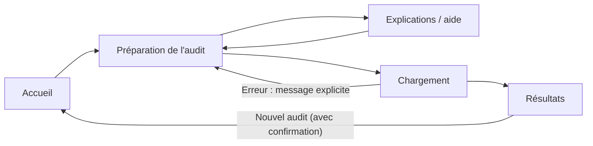
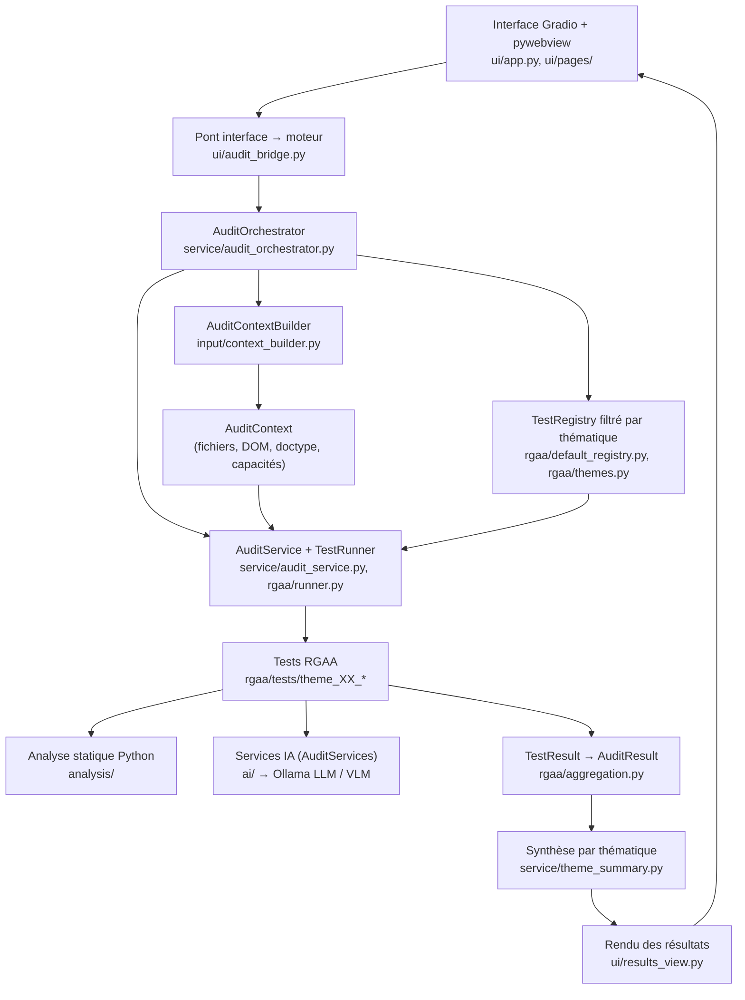

# 💻(9) AccessiCode : Audit d'accessibilité Web (A11y) assisté par IA

> Application de bureau qui aide à repérer les problèmes d'accessibilité d'une page web, en s'appuyant sur le **RGAA 4.1.2**, des contrôles automatiques en Python et des modèles d'IA exécutés via Ollama.


Projet réalisé dans le cadre d'une **SAE** (Situation d'Apprentissage et d'Évaluation) du **BUT Informatique, 3ᵉ année**.

**Groupe BUT3 / TD1 :**

- COUSIN Bastien
- DELDALLE Pierre
- DEQUIDT Clément
- FASQUEL Willard Nathan

**Liens utiles :**

- Trello : https://trello.com/invite/b/6a9e69cd9e7ecc7f81be4bd1/ATTI6d5ce03476f4f8542936dcd7c278e0caA8BD6A55/sae-application-intelligente-accessicode
- Figma : https://www.figma.com/design/8FGVnLvrAo31LO5pBpBqtt/AccessiCode?node-id=0-1&p=f
- Fiche de suivi : https://docs.google.com/document/d/1w9C-9mvlSV3VlXGjUvGZlzjsYjKelKRgISQbcst7Enw/edit?usp=sharing
- Fiche des informations RGAA à traiter par IA ou par algorithme : https://docs.google.com/spreadsheets/d/1b0ENA1tPMe_H5hl4iJYG6QZLoS3Tq-K3sDEvVHtcV9o/edit?usp=sharing

---

## Sommaire

1. [Présentation](#1-présentation)
2. [Fonctionnalités](#2-fonctionnalités)
3. [Aperçu de l'interface](#3-aperçu-de-linterface)
4. [Technologies](#4-technologies)
5. [Architecture](#5-architecture)
6. [Installation](#6-installation)
7. [Configuration de l'IA (Ollama)](#7-configuration-de-lia-ollama)
8. [Lancement et utilisation](#8-lancement-et-utilisation)
9. [Couverture RGAA](#9-couverture-rgaa)
10. [Lecture des résultats](#10-lecture-des-résultats)
11. [Tests et qualité du code](#11-tests-et-qualité-du-code)
12. [Structure du projet](#12-structure-du-projet)
13. [Organisation et contribution](#16-organisation-et-contribution)

---

## 1. Présentation

### Le problème

Vérifier l'accessibilité d'un site demande beaucoup de compétences : connaître les critères du RGAA, lire le HTML, comprendre le fonctionnement des lecteurs d'écran, juger si une alternative d'image ou un titre de page a du sens… Une partie de ces vérifications peut être automatisée, une autre demande de **comprendre le sens** d'un texte ou d'une image.

### Notre réponse

AccessiCode combine trois approches :

| Approche | Quand l'utiliser | Exemple |
|---|---|---|
| **Analyse déterministe** (Python) | La règle est objective | « La page a-t-elle une balise `<title>` ? » |
| **Analyse assistée par IA** (LLM / VLM) | Il faut comprendre un texte ou une image | « Ce titre de page est-il pertinent ? » |
| **Vérification humaine** | La machine n'est pas assez sûre d'elle | Statut `NEEDS_REVIEW` (« à vérifier manuellement ») |

La question qui guide le projet :

> *Comment faciliter les audits d'accessibilité en combinant analyse automatique, IA et restitution compréhensible des résultats, tout en respectant les limites de l'automatisation ?*

### Ce qu'AccessiCode n'est pas

- ❌ Ce n'est **pas un outil de certification** : il ne déclare pas un site « conforme RGAA ».
- ❌ Il ne **remplace pas un audit humain** complet.
- ✅ C'est un **outil de pré-audit** : il repère des anomalies probables, explique pourquoi, propose des corrections et signale ce qui doit être vérifié à la main.

### Pour qui ?

Développeurs web, étudiants et enseignants qui découvrent le RGAA, équipes qualité, ou toute personne qui souhaite réaliser un premier diagnostic technique.

---

## 2. Fonctionnalités

### ✅ Disponible

**Moteur d'audit**

- Moteur modulaire : chaque test RGAA est une classe indépendante, enregistrée dans un registre.
- Analyse du HTML et du DOM avec BeautifulSoup.
- Exécution **asynchrone** des tests, avec isolation des erreurs (un test qui plante n'arrête pas l'audit).
- Vérification des **capacités** nécessaires : un test qui a besoin du DOM n'est lancé que si le DOM est disponible.
- Résultats structurés : statut, observations, élément concerné, recommandation, preuve.
- Services IA (LLM et VLM via Ollama) utilisés par certains tests, avec **repli sans IA** si Ollama est indisponible.

**Interface**

- Application de bureau (fenêtre native pywebview autour d'une interface Gradio).
- Import de fichiers (HTML, images…) et sélection des 13 thématiques RGAA.
- **Filtrage réel** des tests selon les thématiques cochées.
- Page de chargement avec **progression réelle** (étape en cours, nombre de tests terminés).
- Page de résultats avec 13 cartes cliquables et un **score calculé à partir des vrais résultats** du moteur.
- Détail d'une thématique : critères, tests, anomalies et recommandations.
- Messages clairs si un problème empêche l'audit (aucun fichier HTML, thématique sans test, IA indisponible…).
- Page d'aide, bouton « Nouvel audit » avec confirmation, retour automatique en haut de page.

### 🚧 En cours ou prévu

- **Analyse d'une URL** : le champ existe, mais seule l'analyse de fichiers importés fonctionne pour l'instant.
- **Plusieurs pages HTML** : si plusieurs fichiers HTML sont importés, seul le premier est analysé.
- **Estimation du temps** : la durée affichée repose sur des valeurs provisoires, pas sur des mesures réelles.
- **Nouvelles thématiques** : plusieurs thèmes sont développés sur des branches séparées et pas encore fusionnés (voir [Couverture RGAA](#9-couverture-rgaa)).

---

## 3. Aperçu de l'interface

> 📸 *Emplacement réservé : ajouter les captures d'écran dans un dossier `docs/screenshots/`.*

<!--


-->

Le parcours utilisateur :



**Charte graphique** — interface claire et sobre, cohérente avec le sujet du projet :

| Élément | Valeur |
|---|---|
| Bleu principal | `#0153C6` |
| Cyan | `#0CA0B0` |
| Fond neutre | `#F5F5F5` |
| Texte principal | `#17212B` |
| Texte secondaire | `#475569` |
| Typographies | **Sora** (titres), **Inter** (textes et contrôles) |

---

## 4. Technologies

| Outil | Version | Rôle dans le projet |
|---|---|---|
| **Python** | 3.14 | Langage principal (moteur, services, interface) |
| **BeautifulSoup** | 4.15 | Lecture et analyse du HTML / DOM |
| **Gradio** | 6.27 | Construction de l'interface graphique |
| **pywebview** | 6.2 | Affichage de l'interface dans une fenêtre de bureau |
| **Ollama** | — | Exécution des modèles d'IA (LLM et VLM) |
| **aiohttp** | 3.13 | Appels HTTP asynchrones vers l'API Ollama |
| **pydantic-settings** | 2.15 | Chargement de la configuration depuis `.env` |
| **json_repair** | 0.63 | Réparation des réponses JSON mal formées renvoyées par l'IA |
| **langcodes** | 3.5 | Validation des codes de langue (critère 8.4) |
| **Playwright** | 1.63 | Présent dans les dépendances, pas encore utilisé (prévu pour l'analyse d'URL) |
| **pytest** + pytest-asyncio | 9.1 / 1.4 | Tests unitaires, y compris du code asynchrone |
| **Ruff** | 0.16 | Lint et formatage du code |
| **GitHub Actions** | — | Intégration continue (format, lint, tests) |

---

## 5. Architecture

### 5.1 Vue d'ensemble

Le projet est découpé en couches. **Chaque couche ne connaît que celle du dessous** : les tests RGAA ne savent pas qu'il existe une interface Gradio, et l'interface ne contient aucune règle RGAA.



### 5.2 Le déroulement d'un audit, étape par étape

1. **L'utilisateur** importe ses fichiers et coche des thématiques.
2. **`audit_bridge`** transforme les valeurs brutes de Gradio en une `AuditRequest` (fichiers, URL, thématiques).
3. **`AuditOrchestrator`** vérifie la demande (au moins un fichier HTML, au moins une thématique…), puis ne garde dans le registre que les tests des thématiques choisies.
4. **`AuditContextBuilder`** copie les fichiers dans un espace de travail (`workspace/audits/<id>`) et construit un `AuditContext` : DOM, doctype, images et capacités disponibles.
5. **`AuditService`** confie l'exécution au **`TestRunner`**, qui lance chaque test, attrape ses erreurs et signale la progression.
6. Chaque **test RGAA** renvoie un `TestResult`. Les résultats sont **agrégés** par critère dans un `AuditResult`.
7. **`theme_summary`** calcule une synthèse et un score par thématique.
8. **`results_view`** transforme ces synthèses en cartes et en texte affichés par l'interface.

### 5.3 Les principaux composants

| Composant | Fichier | Rôle |
|---|---|---|
| `AuditContextBuilder` | `input/context_builder.py` | Prépare les ressources d'un audit |
| `AuditContext` | `models/audit_context.py` | Contient tout ce dont les tests ont besoin (id, fichiers, DOM, doctype, capacités) |
| `Capability` | `models/capabilities.py` | Liste des ressources disponibles : `HTML_SOURCE`, `DOM`, `IMAGES`, `SCREENSHOT`… |
| `RGAATest` | `rgaa/base.py` | Classe de base de tous les tests RGAA |
| `TestRegistry` | `rgaa/registry.py` | Liste des tests disponibles |
| `build_default_registry()` | `rgaa/default_registry.py` | Construit le registre avec tous les tests implémentés |
| `TestRunner` | `rgaa/runner.py` | Exécute les tests et isole les erreurs |
| `AuditService` | `service/audit_service.py` | Coordonne l'exécution d'un audit |
| `AuditServices` | `service/audit_services.py` | Regroupe les services IA mis à disposition des tests (vide = audit sans IA) |
| `AuditOrchestrator` | `service/audit_orchestrator.py` | Relie une demande utilisateur au moteur, sans dépendre de Gradio |
| `AuditProgress` | `service/audit_progress.py` | Avancement réel de l'audit (aucune progression simulée) |
| `ThemeSummary` | `service/theme_summary.py` | Synthèse et score d'une thématique |

### 5.4 À quoi ressemble un test RGAA ?

Chaque test hérite de `RGAATest`, déclare ce dont il a besoin et implémente une méthode asynchrone `run` :

```python
class Test851(RGAATest):
    test_id = "8.5.1"
    criterion_id = "8.5"
    required_capabilities = frozenset({Capability.DOM})

    async def run(self, context: AuditContext, services=None) -> TestResult:
        ...
```

Pour ajouter un test, il suffit de créer sa classe dans le bon dossier `theme_XX_*` et de l'enregistrer dans `build_default_registry()`. La méthode complète est décrite dans [CONVENTIONS.md](CONVENTIONS.md).

### 5.5 Les modèles de résultats

```text
AuditResult                 ← un audit complet
└── CriterionResult         ← un critère RGAA (ex. 8.5)
    └── TestResult          ← un test (ex. 8.5.1)
        ├── test_id, criterion_id, status, summary
        ├── tested_elements, metadata
        └── Finding         ← une observation sur un élément
            └── element, message, recommendation, evidence
```

**Statuts possibles** :

| Statut | Signification | Affiché comme |
|---|---|---|
| `PASS` | Le contrôle automatique est réussi | Conforme |
| `FAIL` | Une non-conformité est détectée | Non conforme |
| `NEEDS_REVIEW` | La machine n'est pas sûre : un humain doit vérifier | À vérifier manuellement |
| `NOT_APPLICABLE` | Le contrôle ne concerne pas cette page | Non applicable |
| `NOT_TESTED` | Le contrôle n'a pas pu être exécuté (ressource manquante) | Non testé |
| `ERROR` | Une erreur est survenue pendant l'analyse | Erreur d'exécution |

`NEEDS_REVIEW` est essentiel : il permet de **ne pas confondre « je ne sais pas » avec « c'est conforme »**.

---

## 6. Installation

### Prérequis

- **Python 3.14** (version demandée par `pyproject.toml`)
- **Git**
- **Ollama** accessible (en local ou sur un serveur) pour les tests qui utilisent l'IA — *facultatif : sans Ollama, l'application fonctionne mais ces tests ne sont pas réalisés*
- Système utilisé pendant le développement : **Windows** (PowerShell, VS Code). Les autres systèmes n'ont pas été testés officiellement.

### Étapes (PowerShell)

```powershell
# 1. Récupérer le projet
git clone https://github.com/Pierre-Deldalle/SAE_AccessiCode.git
cd SAE_AccessiCode

# 2. Créer et activer un environnement virtuel
py -3.14 -m venv .venv
.\.venv\Scripts\Activate.ps1

# 3. Installer les dépendances
python -m pip install --upgrade pip
pip install -r requirements.txt
pip install -r requirements-dev.txt   # outils de développement : pytest, ruff
```

---

## 7. Configuration de l'IA (Ollama)

La configuration est lue depuis un fichier **`.env`** à la racine du projet (chargé par `pydantic-settings` dans `src/accessi_code/config.py`). Ce fichier est ignoré par Git : **il ne doit jamais être publié**.

Créer un fichier `.env` :

```dotenv
OLLAMA_HOST=http://localhost:11434
LLM_MODEL=gemma4:26b
VLM_MODEL=qwen3-vl:8b-instruct
```

| Variable | Rôle |
|---|---|
| `OLLAMA_HOST` | Adresse du serveur Ollama |
| `LLM_MODEL` | Modèle de langage, pour juger le sens d'un texte (pertinence du titre, de la langue…) |
| `VLM_MODEL` | Modèle de vision, pour analyser le contenu des images |

Les modèles ci-dessus sont ceux utilisés pendant le développement. D'autres modèles Ollama peuvent être essayés, mais les résultats n'ont été évalués qu'avec ceux-ci. Pour les installer en local :

```powershell
ollama pull gemma4:26b
ollama pull qwen3-vl:8b-instruct
```

> ℹ️ Si le `.env` est absent ou invalide, l'audit **continue sans IA** et l'interface affiche un avertissement : les tests qui ont besoin de l'IA ne sont pas réalisés.

---

## 8. Lancement et utilisation

### Lancer l'application de bureau

```powershell
python src/accessi_code/ui/desktop.py
```

Le serveur Gradio démarre en arrière-plan sur `http://127.0.0.1:7860`, puis une fenêtre « AccessiCode » s'ouvre.

Pour lancer uniquement l'interface web (dans le navigateur), par exemple pour déboguer :

```powershell
$env:PYTHONPATH = "src"
python -m accessi_code.ui.app
```

### Réaliser un audit

1. Sur la page d'accueil, cliquer pour **commencer**.
2. **Importer** le fichier HTML de la page à auditer, avec ses ressources (images, etc.).
3. **Choisir les thématiques** RGAA à auditer (toutes sont cochées par défaut ; boutons « Tout sélectionner » / « Tout désélectionner »).
4. Cliquer sur **« Lancer l'audit »** et suivre la progression.
5. Sur la page de résultats, **cliquer sur une carte** pour voir le détail : critères, anomalies, recommandations.
6. **« Nouvel audit »** permet de recommencer (une confirmation évite de perdre les résultats par erreur).

Des pages d'exemple sont disponibles dans [`test_files/`](test_files/) (`basic_site/`, `full_site/`).

---

## 9. Couverture RGAA

Le RGAA 4.1.2 compte **13 thématiques**. L'interface les affiche toutes, mais **toutes ne sont pas encore testées**. Une thématique sans test apparaît comme « Aucun test automatisé disponible ».

### 9.1 Tests intégrés à la branche principale

**12 tests** répartis sur **4 thématiques** :

| Test | Thématique | Ce qui est vérifié | IA |
|---|---|---|---|
| `1.1.1` | 1. Images | Les images porteuses d'information (``, `role="img"`) ont une alternative textuelle | VLM |
| `1.1.2` | 1. Images | Les zones `<area>` des images réactives ont une alternative textuelle | VLM |
| `1.1.3` | 1. Images | Les boutons image (`<input type="image">`) ont une alternative textuelle | — |
| `1.7.1` | 1. Images | La description détaillée d'une image est pertinente | VLM |
| `5.1.1` | 5. Tableaux | Les tableaux de données complexes ont un résumé | — |
| `8.1.1` | 8. Éléments obligatoires | Le type de document (doctype) est présent | — |
| `8.1.2` | 8. Éléments obligatoires | Le doctype est valide | — |
| `8.1.3` | 8. Éléments obligatoires | Le doctype est déclaré avant la balise `<html>` | — |
| `8.4.1` | 8. Éléments obligatoires | La langue par défaut de la page est valide et pertinente | LLM |
| `8.5.1` | 8. Éléments obligatoires | La page possède un titre (`<title>`) | — |
| `8.6.1` | 8. Éléments obligatoires | Le titre de la page est pertinent | LLM |
| `11.1.1` | 11. Formulaires | Chaque champ de formulaire a une étiquette | — |

*« IA » indique que le test peut faire appel à un modèle d'IA pour juger le sens. Sans IA, il se limite à la partie automatique, ou renvoie « à vérifier manuellement ».*

### 9.2 Thématiques en cours de développement

D'autres thématiques sont développées sur des branches séparées (une branche par *user story*) et seront fusionnées après relecture :

| Thématique | Branche(s) de travail |
|---|---|
| 2. Cadres | `tests` |
| 3. Couleurs | `us_2.0.3` |
| 4. Multimédia | `us_2.0.4`, `us_2.0.5` |
| 6. Liens | `us_2.0.6` — 6 tests (6.1.1 à 6.1.5, 6.2.1) |
| 7. Scripts | `us_2.0.7` |
| 9. Structuration de l'information | `us_2.0.9` |
| 10. Présentation de l'information | `us_2.0.10` |
| 12. Navigation | `tests` |
| 13. Consultation | *pas encore commencée* |

<details>
<summary><strong>Focus : le thème 6 (Liens), en cours d'intégration</strong></summary>

Le thème 6 est l'un des plus avancés. Il distingue plusieurs types de liens pour ne pas les compter deux fois :

| Test | Rôle |
|---|---|
| `6.1.1` | Liens textuels : intitulé et contexte (`aria-label`, `aria-labelledby`, `role="link"`…) |
| `6.1.2` | Liens images : alternative textuelle de l'image |
| `6.1.3` | Liens composites (texte + image) : reconstitution de l'intitulé |
| `6.1.4` | Liens SVG |
| `6.1.5` | L'intitulé visible est bien inclus dans le nom accessible |
| `6.2.1` | Le lien possède un intitulé |

Exemples de problèmes détectés :

```html
<!-- 6.1.5 : le texte visible « Contact » n'est pas dans le nom accessible « Envoyer un message » -->
<a href="/contact" aria-label="Envoyer un message">Contact</a>

<!-- 6.2.1 : lien sans aucun intitulé -->
<a href="/contact"></a>
```

</details>

---

## 10. Lecture des résultats

### Comment le score est calculé

Le score d'une thématique est calculé **au niveau des critères** :

```text
score = critères conformes / (critères conformes + critères non conformes)
```

- Seuls les critères **tranchés** (`PASS` ou `FAIL`) entrent dans le calcul.
- Les critères « à vérifier », en erreur, non testés ou non applicables sont **comptés à part** et affichés dans le détail.
- S'il n'y a aucun critère tranché, **aucun pourcentage n'est affiché**.

### Code couleur

| Couleur | Signification |
|---|---|
| 🔴 Rouge (0–35 %) | Priorité élevée |
| 🟡 Jaune (36–65 %) | À surveiller |
| 🟢 Vert (66–100 %) | Satisfaisant |
| 🔵 Cyan | À vérifier manuellement |
| ⚪ Gris | Non évaluée (non sélectionnée ou sans test) |

> ⚠️ **Ces seuils sont propres à AccessiCode.** Ils servent à prioriser les corrections. Le score porte uniquement sur les tests implémentés : **ce n'est pas un taux officiel de conformité RGAA.**

---

## 11. Tests et qualité du code

### Lancer les tests

```powershell
# Tous les tests
python -m pytest -q

# Un dossier précis, par exemple les tests du thème 8
python -m pytest tests/unit/rgaa/theme_08_mandatory/ -v
```

Dernier résultat sur la branche de développement (novembre 2026) : **238 tests réussis**.

Les tests couvrent le moteur (registre, runner, agrégation), la préparation des fichiers, chaque test RGAA, l'orchestration, le calcul des scores et le rendu des résultats. L'IA est **simulée** dans les tests unitaires : ils n'ont pas besoin d'Ollama.

### Qualité du code

```powershell
python -m ruff check .          # lint
python -m ruff format --check . # vérification du formatage
python -m ruff format .         # formatage automatique
```

Règles Ruff activées : `E`, `F`, `W` (pycodestyle et Pyflakes) et `I` (ordre des imports), lignes de 120 caractères.

### Intégration continue

À chaque *push* ou *pull request* sur `main`, GitHub Actions ([`.github/workflows/ci.yml`](.github/workflows/ci.yml)) vérifie le formatage, le lint, la syntaxe Python et lance les tests.

### Scripts de débogage

Le dossier [`scripts/`](scripts/) contient des scripts pour tester le moteur sans interface : `debug_context.py`, `debug_engine.py`, `debug_rgaa.py`.

---

## 12. Structure du projet

```text
SAE_AccessiCode/
├── .github/workflows/ci.yml      # Intégration continue
├── CONVENTIONS.md                # Méthode pour ajouter un test RGAA
├── pyproject.toml                # Configuration Python, Ruff et pytest
├── requirements.txt              # Dépendances de l'application
├── requirements-dev.txt          # Dépendances de développement
├── scripts/                      # Scripts de débogage du moteur
├── test_files/                   # Pages HTML d'exemple à auditer
├── workspace/audits/             # Copies des fichiers de chaque audit (ignoré par Git)
├── tests/unit/                   # Tests unitaires (analysis, input, rgaa, service, ui)
└── src/accessi_code/
    ├── config.py                 # Lecture du .env
    ├── ai/                       # Clients Ollama, analyseurs d'images et de page, prompts
    ├── analysis/                 # Fonctions d'analyse HTML (DOM, images, page, tableaux)
    ├── input/                    # Collecte, classement des fichiers et construction du contexte
    ├── models/                   # AuditContext, Capability, TestResult, AuditResult…
    ├── rgaa/
    │   ├── base.py               # Classe RGAATest
    │   ├── registry.py           # TestRegistry
    │   ├── default_registry.py   # Liste des tests implémentés
    │   ├── runner.py             # TestRunner
    │   ├── aggregation.py        # Regroupement des résultats par critère
    │   ├── themes.py             # Les 13 thématiques et le filtrage du registre
    │   └── tests/                # Un dossier par thématique (theme_01_images, …)
    ├── service/                  # AuditService, orchestrateur, progression, synthèse
    ├── docs/monitoring/          # Comptes rendus de sprint (sprint_00 à sprint_04)
    └── ui/
        ├── desktop.py            # Point d'entrée : fenêtre de bureau
        ├── app.py                # Construction de l'application Gradio
        ├── audit_bridge.py       # Pont interface → orchestrateur
        ├── loading_view.py       # Rendu de la progression
        ├── results_view.py       # Rendu des cartes et du détail des résultats
        ├── pages/                # accueil, preparation_audit, explications, chargement, resultats
        ├── components/           # Composants réutilisables (boutons, zone de dépôt, texte)
        ├── styles/               # Feuilles CSS par page
        └── assets/               # Logos et icône
```

---

## 13. Organisation et contribution

### Méthode de travail

- Travail en **sprints** (méthode agile) suivis sur **Trello** ; les comptes rendus sont dans [`src/accessi_code/docs/monitoring/`](src/accessi_code/docs/monitoring/).
- **Une branche par user story** (`us_<sprint>.<numéro>`, par exemple `us_2.0.6` pour le thème 6), fusionnée dans `main` par *pull request*.
- Maquettes de l'interface réalisées sur **Figma**.

### Contribuer

1. Créer une branche depuis `main`.
2. Pour un nouveau test RGAA, suivre [CONVENTIONS.md](CONVENTIONS.md) et **vérifier la règle dans la documentation officielle du RGAA** avant de coder.
3. Ajouter les tests unitaires correspondants dans `tests/unit/`.
4. Vérifier avant la *pull request* :

   ```powershell
   python -m ruff format .
   python -m ruff check .
   python -m pytest -q
   ```


